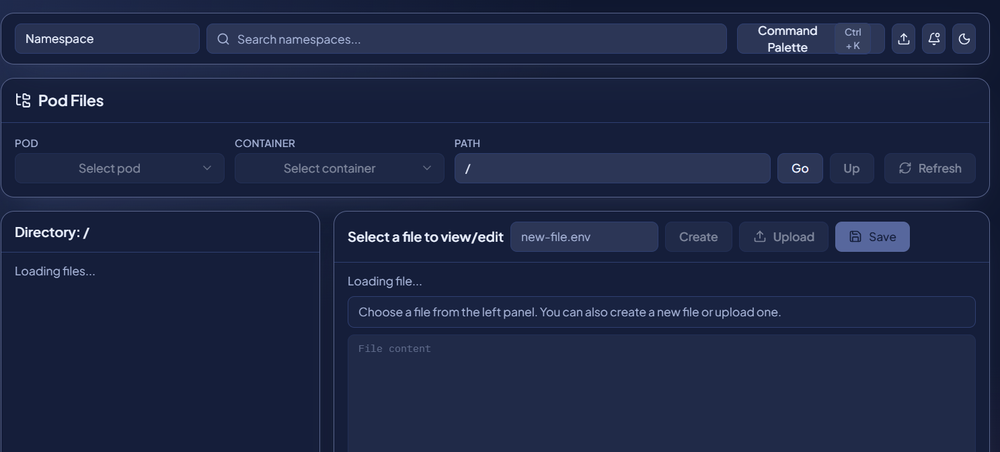

# K8 Studio (Docker Distribution)

K8 Studio is a Kubernetes operations UI distributed as prebuilt Docker images.
This repository is intentionally **deployment-only** and contains only `docker-compose.yml` for running the product.

## What You Get

- Multi-context Kubernetes UI
- Pods, Deployments, StatefulSets, PVCs, Services
- Pod terminal access
- Pod files explorer
- Logs viewer and download
- Port forwarding from UI
- Environment variable view/edit workflows
- Resource monitoring (CPU/Memory)

## Screenshots




## Supported Clusters

Any cluster reachable via your kubeconfig, including:

- Kubernetes (generic)
- GKE
- AKS
- EKS
- kind
- Docker Desktop Kubernetes

## Prerequisites

- Docker / Docker Desktop installed
- Access to your Kubernetes clusters (kubeconfig on host)
- If private images are used, Docker Hub login:

```bash
docker login
```

## Run K8 Studio

From this repository:

```bash
docker compose up -d
```

Open:

- `http://localhost:3453`

## Stop K8 Studio

```bash
docker compose down
```

## Pull Latest Images

```bash
docker compose pull
docker compose up -d
```

## Notes

- Backend runs internally on Docker network; only frontend UI is exposed.
- Kubernetes/cloud config directories are mounted from host as read-only.
- UI-managed port-forwarding uses the host port range configured in `docker-compose.yml`.

## Troubleshooting

- Contexts not visible:
  - verify kubeconfig: `kubectl config get-contexts`
- Port-forward URL not reachable:
  - ensure selected local port is within configured published range and not already in use
- Cluster auth issues:
  - refresh cloud auth session (`gcloud auth login`, `az login`, etc.)

## Native Mac and Linux images

Both images provide linux/arm64 (Apple Silicon) and linux/amd64 manifests.
No source directories or local build are required. After updating this repository:

```bash
git checkout develop
git pull origin develop
docker compose up -d
```

Compose pulls the latest images automatically. Do not add backend/frontend build
contexts to this distribution repository.

## Optional organization CA

Ask your administrator for the approved CA chain as public PEM certificates.
Keep this file outside the repository and image. On macOS/Linux:

```bash
export K8_STUDIO_EXTRA_CA_CERTS_HOST=/absolute/path/to/approved-ca.pem
docker compose -f docker-compose.yml -f docker-compose.ca.example.yml up -d
```

On Windows PowerShell, set `$env:K8_STUDIO_EXTRA_CA_CERTS_HOST = 'C:\path\to\approved-ca.pem'`
then run the same Compose command. The file is mounted read-only; TLS and hostname
verification remain enabled. Explicit kubeconfig CA settings take precedence.

After host cloud login (for example `gcloud auth login`), use Check in the UI.
Credential mounts stay live, so restarting Docker is unnecessary.
